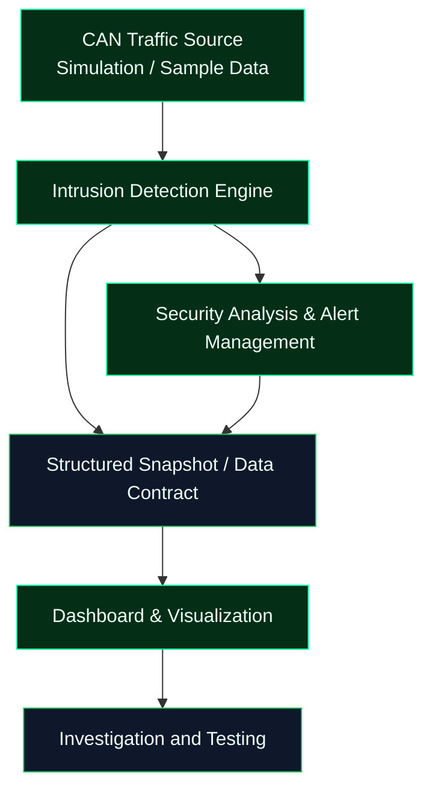

 

  

**An evolving automotive cybersecurity project for exploring CAN traffic analysis and ECU intrusion detection.**

[Repository](https://github.com/Rafiq-root/CAN-Sentinel) · [Issues](https://github.com/Rafiq-root/CAN-Sentinel/issues) · [Contributors](https://github.com/Rafiq-root/CAN-Sentinel/graphs/contributors)

---

## `> SYSTEM_OVERVIEW`

CAN-Sentinel is being developed to explore how suspicious activity on a **Controller Area Network (CAN)** can be identified, investigated, and presented to a security analyst. The project is split into modules for traffic simulation, intrusion detection, alert management, and dashboard integration.

> [!IMPORTANT]
> **Active development:** This repository is a work in progress. The visual elements and badges below do not imply that every planned feature is implemented or that the full system is production-ready.

## `> ARCHITECTURE`

*This is the intended high-level workflow. Connections and capabilities will be confirmed as integration and testing progress.*

## `> MODULES`

<table>
  <tr>
    <td width="50%">
      <h3>01 / CAN Data & Simulation</h3>
      Develops traffic sources and representative CAN message samples. 
      Branch: <code>member-1</code>
    </td>
    <td width="50%">
      <h3>02 / Intrusion Detection</h3>
      Develops analysis logic for identifying suspicious traffic patterns. 
      Branch: <code>Member-2</code>
    </td>
  </tr>
  <tr>
    <td width="50%">
      <h3>03 / Alert Management</h3>
      Handles alert structure, validation, severity, and storage components. 
      Branch: <code>member-3</code>
    </td>
    <td width="50%">
      <h3>04 / Dashboard & Integration</h3>
      Develops the monitoring interface and module integration contract. 
      Branch: <code>member-4</code>
    </td>
  </tr>
</table>

> **Branch-name note:** The detection-engine branch currently appears as `Member-2` with a capital **M**.

## `> TECH_STACK`

  
  
  
  
  

The final dependency list will be recorded once the integrated implementation is confirmed. Badges describe the current project direction and should not be read as proof that all components are complete.

## `> DEVELOPMENT_STATUS`

| Workstream | Status |
|---|---|
| CAN traffic source and sample data | In progress |
| Intrusion-detection engine | In progress |
| Alert schemas and management | Module development |
| Dashboard interface | In progress |
| Cross-module integration | Pending / ongoing |
| End-to-end validation | Pending |

These are project-level summaries. Update them as a team when implementation and tests change the actual state.

## `> ROADMAP`

- [ ] Validate CAN traffic samples and simulation
- [ ] Implement and test detection rules
- [ ] Finalize alert schema, severity handling, and storage
- [ ] Build the dashboard interface
- [ ] Integrate modules through a documented data contract
- [ ] Add verified setup and execution instructions
- [ ] Run end-to-end tests with normal and suspicious traffic
- [ ] Publish dashboard screenshots and evaluation results

## `> LIVE_REPOSITORY_METRICS`

  
  

  
  
  

Statistics are served by external badge/statistics services and may be delayed, rate-limited, or temporarily unavailable. Account-wide language statistics are not a measure of this repository alone.

## `> CONTRIBUTION_ACTIVITY`

  

<a href="https://github.com/Rafiq-root/CAN-Sentinel/graphs/contributors">
  **VIEW TEAM CONTRIBUTION HISTORY →**
</a>

## `> TEAM_WORKFLOW`

- `main` — stable project baseline; merge after review.
- `develop` — shared integration branch.
- Module branches — independent implementation and testing.

Recommended flow: work on your module branch → test your changes → open a pull request into `develop` → review integration → merge to `main` when the team considers the baseline ready.

## `> SETUP`

The complete application setup is not documented yet because end-to-end integration is still underway. Before adding run commands here, confirm the actual dependencies, entry point, and test procedure from the integrated repository. Do not assume the entire system can currently be launched with a single command.

## `> SECURITY_AND_SCOPE`

CAN-Sentinel is an educational project for authorized automotive cybersecurity research and controlled testing. It is **not** a certified automotive safety or production security system. Detection results may be incomplete or inaccurate. Never test against vehicles, devices, or networks without authorization.

---

**`CAN-SENTINEL // OBSERVE • ANALYZE • DEFEND`**

Collaborative automotive cybersecurity project · Under active development

