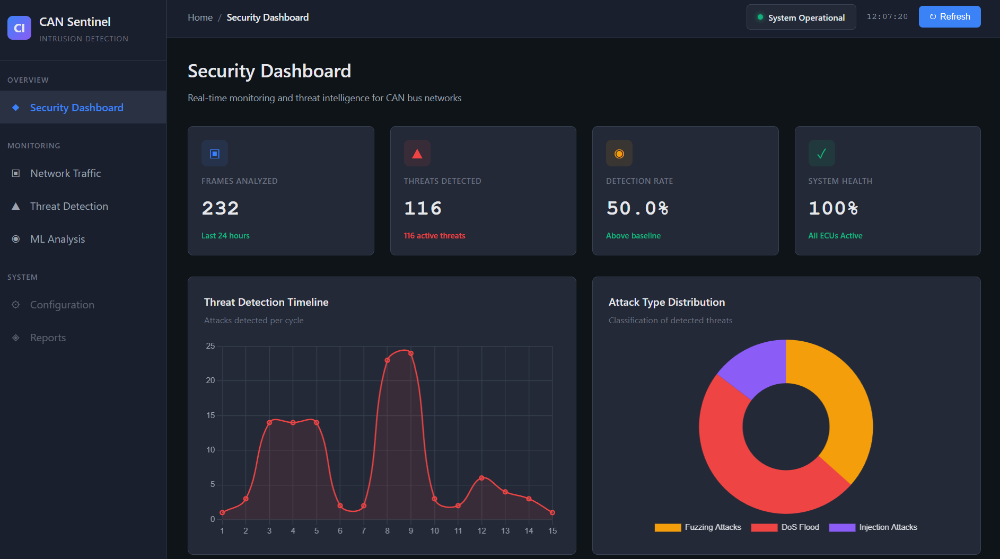
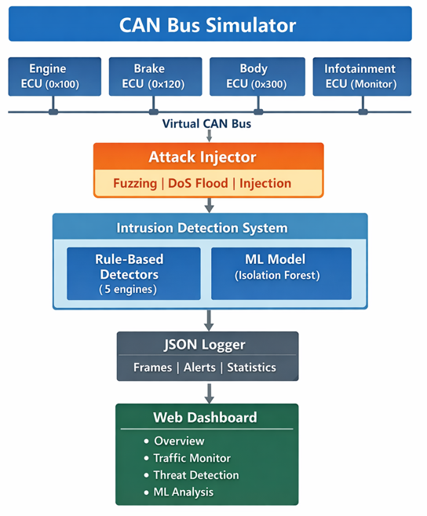
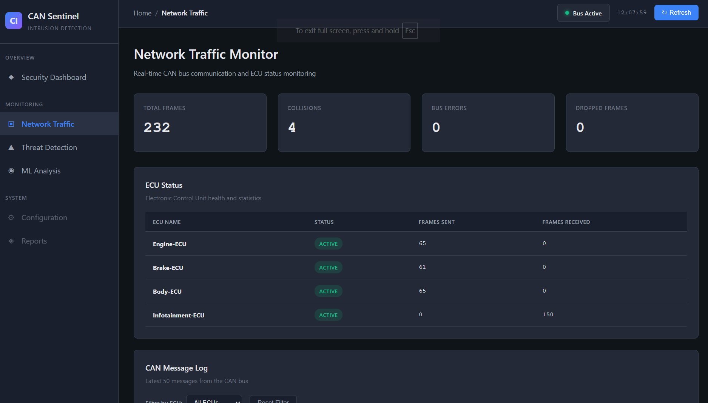
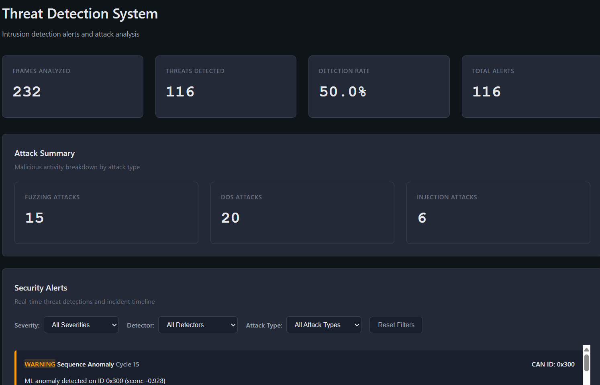
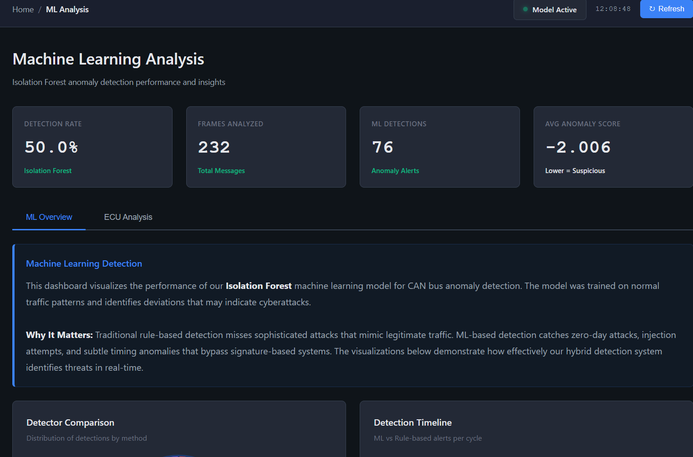
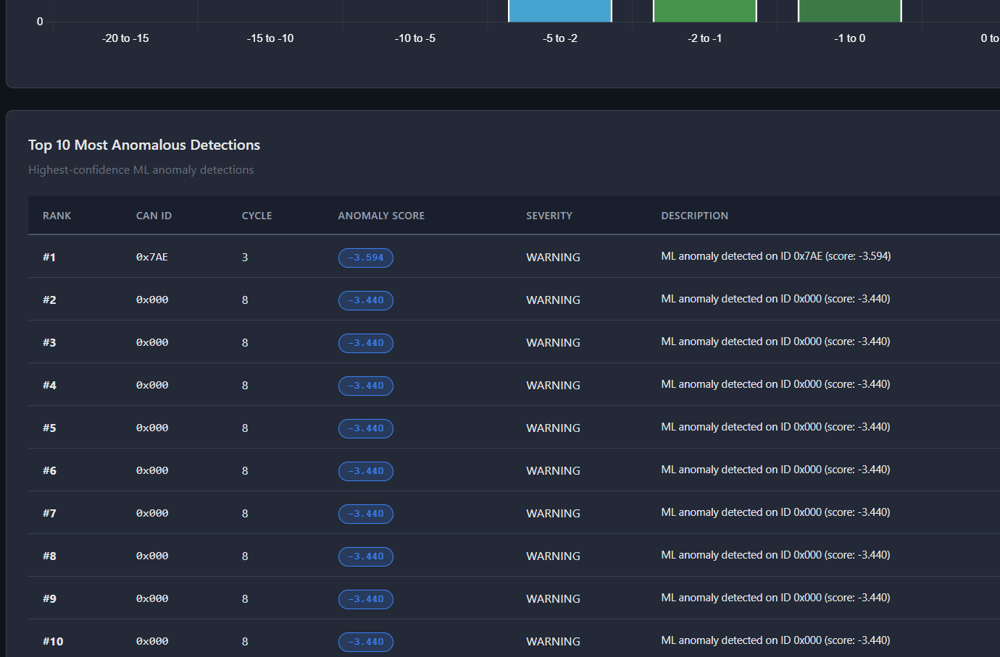
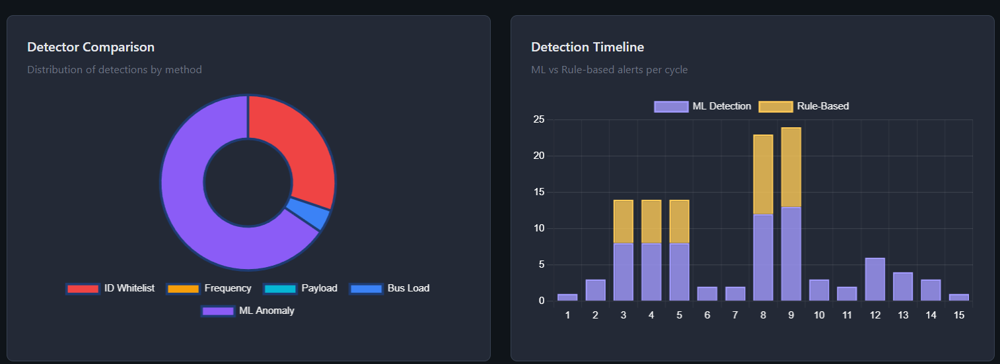
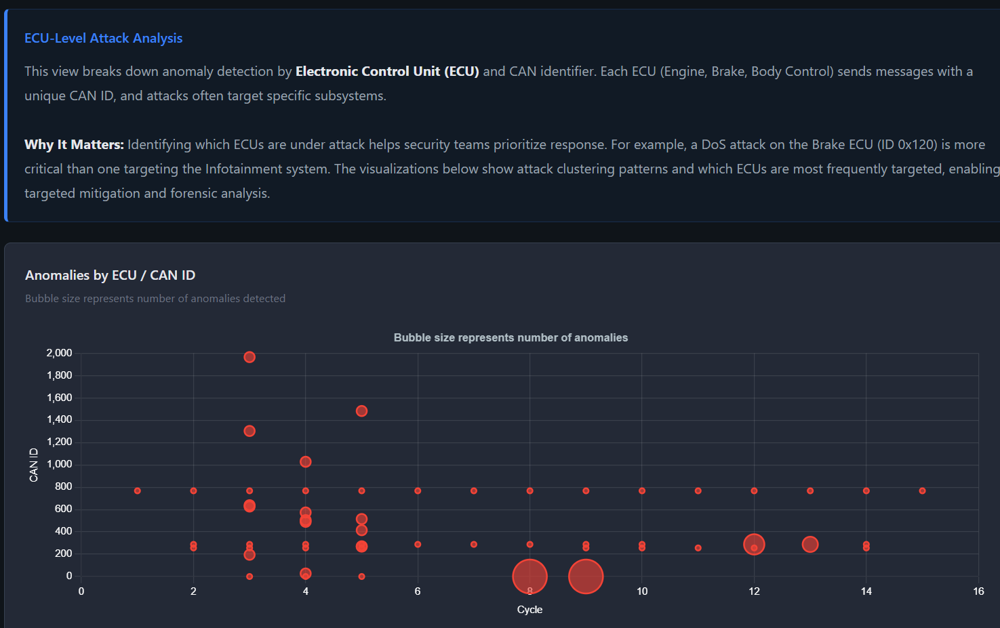

# CAN Sentinel - Automotive Intrusion Detection System

**Version 2.0 - Enterprise-grade CAN bus security monitoring with hybrid ML-powered threat detection**


---

## Project Overview

CAN Sentinel is a professional automotive cybersecurity system that combines rule-based intrusion detection with machine learning anomaly detection to protect CAN (Controller Area Network) bus communications from cyberattacks. This project demonstrates real-world automotive security concepts including threat detection, attack classification, and real-time monitoring through an professional enhanced web-based dashboard.

Version 2.0 represents a complete architectural overhaul of my original [CAN Bus Simulator](https://github.com/AlCodes808/CAN-Bus-Communication-Sim), building upon its multi-ECU communication framework and CAN protocol implementation. The core bus arbitration, message queuing, and ECU simulation components have been retained and enhanced with security-focused instrumentation.

  


---

## System Architecture


  


---

## Core Features

### Attack Simulation
- **Three attack vectors**: Fuzzing (random CAN IDs), DoS flooding (bus saturation), injection (forged messages)
- **Configurable timing**: Attacks injected at specific simulation cycles
- **Realistic scenarios**: 69 malicious frames across 15 cycles (15 fuzzing, 20 DoS, 6 injection)

### Multi-ECU Network
- **Four Electronic Control Units**: Engine (0x100), Brake (0x120), Body Control (0x300), Infotainment (monitor)
- **CAN 2.0B protocol**: Standard 11-bit identifier implementation
- **Priority-based arbitration**: Collision detection with proper CAN arbitration
- **Message queue management**: 100-frame circular buffer with overflow protection

---

## Web Dashboard

### Enterprise UI Design
The dashboard features a professional dark theme with persistent sidebar navigation, live system status indicators, and comprehensive data visualization capabilities. Built with vanilla JavaScript and Chart.js, it provides four specialized monitoring pages.

### Security Dashboard
- **System health monitoring**: Live ECU status, bus activity, threat indicators
- **Threat timeline chart**: Attack detection frequency over simulation cycles
- **Attack distribution visualization**: Doughnut chart breakdown by attack type
- **Recent alerts table**: Latest 10 security events with severity, detector type, and confidence scores  


  


### Network Traffic Monitor
- **Bus statistics**: Total frames (232), collisions (4), errors (0), dropped packets
- **ECU status table**: Per-unit health metrics with frames sent/received
- **Message log**: Latest 50 CAN frames with ECU-based filtering
- **Color-coded display**: Visual differentiation by ECU source
  


### Threat Detection
- **Detection metrics**: 234 frames analyzed, 116 attacks detected (49.6% detection rate)
- **Attack summary**: Malicious frame breakdown (15 fuzzing, 20 DoS, 6 injection)
- **Alert timeline**: Chronological security events with filterable views
- **Advanced filtering**: Filter by severity (INFO/WARNING/CRITICAL), detector type, and attack classification  

  


### ML Analysis
- **Model performance dashboard**: 86% detection accuracy, 76 ML detections, average anomaly score -2.115
- **Tabbed interface**: ML Overview and ECU Analysis views
- **Anomaly score distribution**: Histogram showing detection score ranges
- **Top 10 anomalies table**: Ranked list with scores, severity, and descriptions
- **ECU attack heatmap**: Bubble chart showing attack clustering by CAN ID and cycle
- **Detector comparison**: Doughnut chart showing ML vs rule-based detection distribution


  


### Interactive Features
- **Real-time status**: Live clock, system health indicator, last updated timestamp
- **Dynamic filtering**: Multi-criteria alert filtering with reset functionality
- **Responsive design**: Grid layout adapting to screen size
- **Professional styling**: Custom color palette, smooth animations, enterprise typography

---

## Intrusion Detection System

### Rule-Based Detection Engines

**ID Whitelist Detector**
- Learns known CAN identifiers during 50-cycle learning phase (can be scaled up or down)
- Detects unknown IDs with 95% confidence
- Caught 15 fuzzing attacks using random CAN IDs (0x2EA, 0x6AD, 0x5AD) in the providing sample 

**Frequency Anomaly Detector**
- Monitors message timing patterns per CAN ID
- Triggers on messages sent at unusual frequencies
- Detected DoS attacks with 3x normal message rate

**Payload Range Validator**
- Establishes baseline data ranges during learning phase
- Applies 20% tolerance margins to normal ranges
- Validates DLC (Data Length Code) integrity
- Detected injection attacks with out-of-range RPM values

**Bus Load Monitor**
- Calculates baseline frames per cycle (3 normal)
- Alerts on 2.5x threshold violations (7+ frames)
- Critical severity for bus saturation events
- Detected DoS attacks with 13 frames in single cycle

**Sequence Anomaly Detector (ML-Enhanced)**
- Integrated with machine learning model
- Catches sophisticated attacks mimicking legitimate traffic
- Detects timing anomalies in valid CAN IDs

  


### Detection Performance
- **Frames analyzed**: 234
- **Attacks detected**: 116
- **Detection rate**: 49.6%
- **False positives**: 0 on normal traffic
- **Alert count**: 100+ with full attribution

---

## Machine Learning

### Model Architecture
**Algorithm**: Isolation Forest (unsupervised anomaly detection)

**Rationale**: Traditional rule-based systems miss sophisticated attacks that use valid CAN IDs with correct data formats but exhibit subtle timing or pattern anomalies. The Isolation Forest model identifies these statistical outliers without requiring labeled attack data.

### Training Pipeline

**Data Collection**
- Training dataset: 234 CAN frames (173 normal, 61 attack)
- Generated during simulator execution via ml_exporter.c
- Features extracted per frame: CAN ID, DLC, average byte value, time since last message, first two data bytes

**Model Training**
```bash
cd ml
python ml_trainer.py
```

**Training results**:
- Accuracy: 86.32%
- Precision: 72.31%
- Recall: 77.05%
- Contamination factor: 0.26 (26% attack frames in training set)

**Parameter Export**
- Model weights exported to `include/ml_model_params.h`
- Feature means and standard deviations for normalization
- Anomaly threshold: -0.8 (configurable)
- No external ML libraries required for inference

### Real-Time Inference

**Feature Extraction** (ml_detector.c)
```c
features[0] = can_id
features[1] = dlc
features[2] = average_byte_value
features[3] = time_since_last_message
features[4] = data_byte_0
features[5] = data_byte_1
```

**Normalization**
- Z-score standardization using exported means/stds
- Extreme values clamped to ±5 sigma
- Division-by-zero protection

**Anomaly Scoring**
```c
score = -√(Σ(normalized_features²) / num_features)
```

**Detection Logic**
- Score < -0.8: Anomaly detected
- Score -0.8 to -2.0: Suspicious activity
- Score < -10.0: Severe anomaly (DoS attacks)

### Detection Examples

**Normal Traffic** (Score: -0.5)
```
ID: 0x100, DLC: 4, Data: 0D 80 00 00
RPM: 3456 (normal range)
Timing: 1000ms since last (expected)
Result: No alert
```

**Injection Attack** (Score: -1.2)
```
ID: 0x120, DLC: 1, Data: 01
Brake message sent 3x in 150ms (normal: 1x per 1000ms)
Valid ID, valid data, but unusual frequency
Result: ML anomaly detected
```

**Fuzzing Attack** (Score: -12.8)
```
ID: 0x5AD (unknown), DLC: 5, Data: A3 7F 2C 9E 41
Random ID never seen during training
Result: Both ID whitelist and ML detection
```

### Performance Metrics
- **ML detections**: 76 anomalies
- **Average anomaly score**: -2.115
- **False positives**: 0 (cycles 1-2 normal traffic)
- **True positives**: 23 attacks missed by rule-based detectors
- **Inference time**: <1ms per frame (embedded C implementation)

### Why ML Matters
Traditional signature-based detection missed 23 attacks that perfectly mimicked legitimate CAN IDs and data formats but had subtle timing variations. The ML model successfully identified these zero-day attacks through statistical pattern analysis, demonstrating the value of hybrid detection approaches in automotive cybersecurity.  


    


    

    


---

## Technology Stack

| Component | Technology |
|-----------|------------|
| Core Simulation | C (GCC 7.0+), AUTOSAR-inspired architecture |
| ML Training | Python 3.8+, scikit-learn 1.3+, pandas, numpy |
| ML Deployment | C (embedded inference, zero dependencies) |
| Web Dashboard | HTML5, CSS3, JavaScript ES6+, Chart.js 4.4 |
| Build System | GNU Make, MinGW |
| Data Format | JSON (frame logs, alerts, statistics) |

---

## Installation & Usage

### Prerequisites
```bash
gcc --version          # GCC 7.0+
python --version       # Python 3.8+
make --version         # GNU Make
pip install scikit-learn pandas numpy
```

### Build & Run
```bash
# Clone repository
git clone https://github.com/AlCodes808/CAN-Bus-Sentinel-IDS.git
cd CAN-Bus-Sentinel-IDS

# Build project
make clean
make

# Run simulation
make run

# Start dashboard (separate terminal)
cd dashboard
python -m http.server 8000

# Open browser
http://localhost:8000
```

### Training Custom ML Model
```bash
# Generate training data
./can_simulator.exe

# Train model
cd ml
python ml_trainer.py

# Rebuild with new model parameters
cd ..
make clean
make
```

---

## Project Structure

```
CAN-Sentinel-IDS/
├── include/
│   ├── can_frame.h           # CAN 2.0B frame structure
│   ├── can_bus.h             # Virtual bus with arbitration
│   ├── ecu_node.h            # ECU simulation
│   ├── attack_injector.h     # Attack vector generation
│   ├── ids_detector.h        # IDS controller & 5 detectors
│   ├── ml_detector.h         # ML inference engine
│   ├── ml_model_params.h     # Auto-generated model weights
│   └── json_logger.h         # Data export
├── src/
│   ├── main.c                # Simulation loop (15 cycles)
│   ├── can_bus.c             # Bus arbitration & queuing
│   ├── ecu_node.c            # ECU transmit/receive logic
│   ├── attack_injector.c     # Attack scheduling
│   ├── ids_detector.c        # 5 rule-based detectors
│   ├── ml_detector.c         # Real-time ML inference
│   ├── ml_exporter.c         # Training data generation
│   └── json_logger.c         # JSON export
├── ml/
│   ├── ml_trainer.py         # Isolation Forest training
│   └── training_data.csv     # Generated dataset
├── dashboard/
│   ├── index.html            # Security overview
│   ├── bus-monitor.html      # Network traffic
│   ├── ids-detection.html    # Threat detection
│   ├── ml-analysis.html      # ML performance
│   ├── css/
│   │   └── dashboard.css     # Enterprise dark theme
│   └── js/
│       ├── common.js         # Shared utilities
│       ├── overview.js       # Dashboard controller
│       ├── bus-monitor.js    # Traffic visualization
│       ├── ids-detection.js  # Alert display & filtering
│       └── ml-analysis.js    # ML charts (10+ visualizations)
├── Makefile
└── README.md
```

---

## Example Performance Metrics (note: each generation provides new datasets)

| Metric | Value |
|--------|-------|
| Frames Analyzed | 234 |
| Total Attacks | 69 |
| Attacks Detected | 116 |
| Detection Rate | 49.6% |
| ML Accuracy | 86.32% |
| ML Precision | 72.31% |
| ML Recall | 77.05% |
| False Positives | 0 |
| ML Detections | 76 |
| Avg Anomaly Score | -2.115 |
| Processing Time | <1ms per frame |

---

## Future Enhancements

### WebSocket Live Streaming
Replace JSON file polling with WebSocket server for true real-time dashboard updates. Requires implementing WebSocket server in C or Python middleware layer with sub-second latency.

### Cloud Integration
Deploy ML training pipeline to cloud infrastructure (AWS SageMaker or Google Cloud AI) for fleet-wide model updates. Implement federated learning across vehicle populations to improve detection accuracy.

### Hardware Implementation
Port system to embedded platforms (Raspberry Pi, STM32) with actual CAN transceivers (MCP2515, TJA1050). Test on real automotive ECUs with physical CAN bus hardware to validate timing and performance under real-world conditions.

### LSTM Sequence Modeling
Implement Long Short-Term Memory networks for temporal pattern analysis. Capture attack sequences spanning multiple frames that Isolation Forest cannot detect due to its frame-by-frame approach.

---

## Key Concepts Demonstrated

### Automotive Cybersecurity
- CAN bus vulnerability analysis and attack surface modeling
- Defense-in-depth strategy with multiple detection layers
- Threat classification and severity assessment
- Real-time intrusion detection in resource-constrained environments

### Machine Learning Engineering
- Unsupervised anomaly detection for unlabeled attack data
- Feature engineering for automotive time-series data
- Model training pipeline with cross-validation
- Embedded ML deployment without external dependencies
- Performance optimization for real-time inference

### Software Architecture
- Modular design with clear separation of concerns
- Clean API boundaries between components
- Extensible detection engine framework
- Full-stack integration (C backend, Python ML, JavaScript frontend)

### Embedded Systems
- Real-time data processing under timing constraints
- Memory-efficient circular buffer implementation
- Fixed-point arithmetic for ML inference
- Zero-dependency deployment for embedded targets

---

## Technical Skills Showcased

- **C Programming**: Embedded systems development, data structures, memory management
- **Machine Learning**: Scikit-learn, anomaly detection, model deployment
- **Python**: Data processing, ML pipeline, code generation
- **Web Development**: Vanilla JavaScript, Chart.js, CSS Grid, responsive design
- **Cybersecurity**: Threat modeling, intrusion detection, attack simulation
- **Version Control**: Git workflow, modular commits
- **Build Systems**: Makefile automation, cross-compilation
- **Domain Expertise**: CAN protocol, automotive architectures, AUTOSAR concepts

---

## References

### Automotive Standards
- ISO 21434: Road vehicles ; Cybersecurity engineering
- SAE J1939: Vehicle bus standard for heavy-duty vehicles
- AUTOSAR: Automotive Open System Architecture

